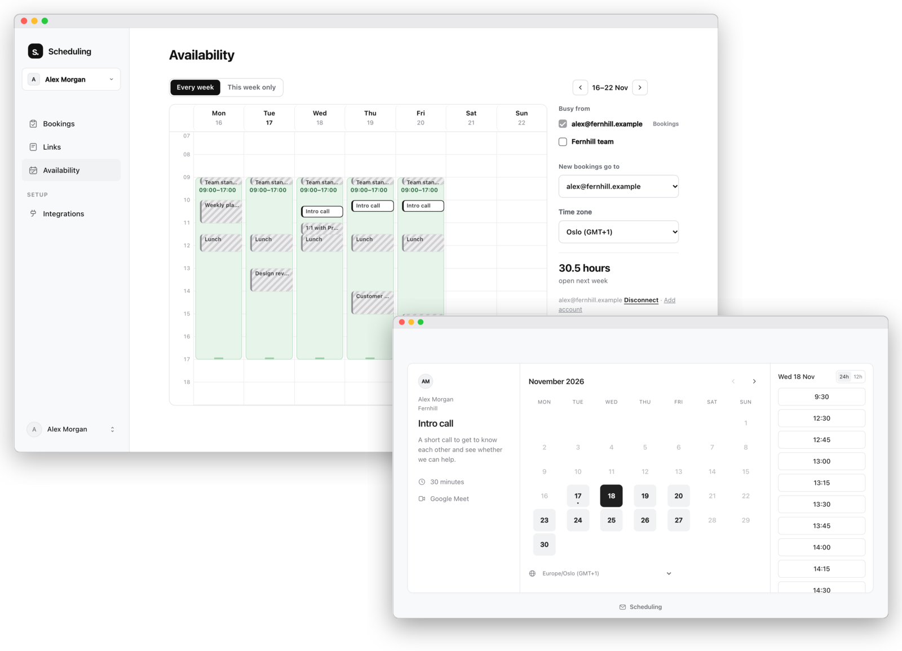
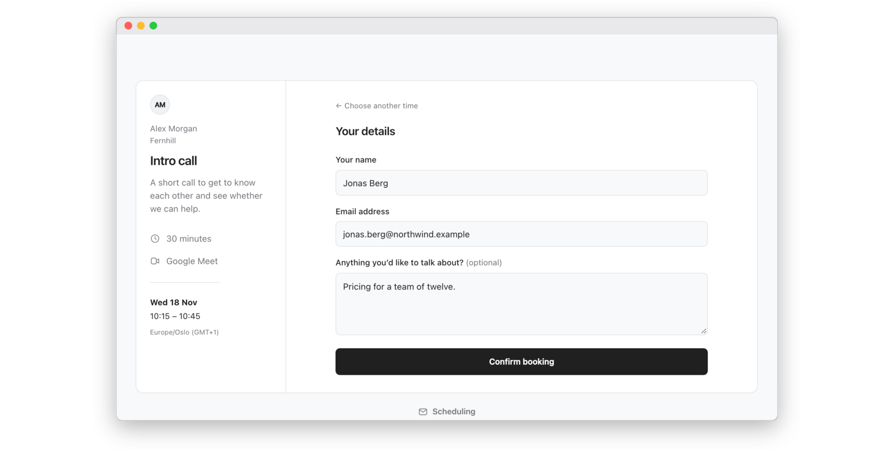
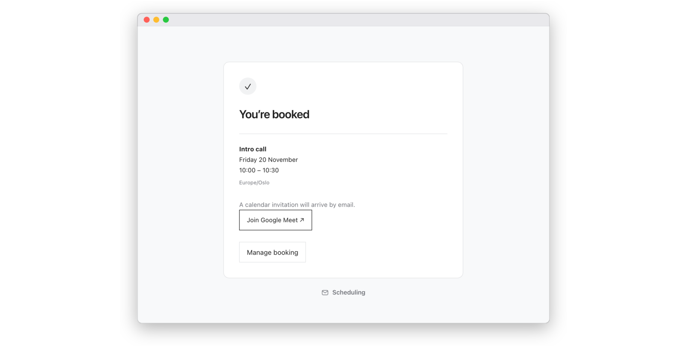
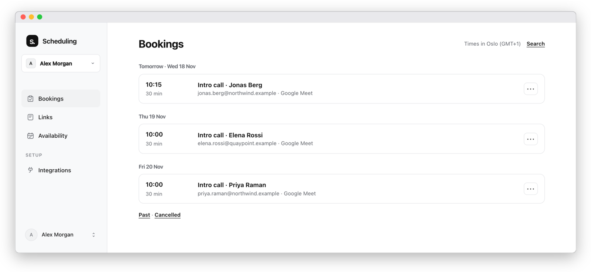

<p align="center">
  
</p>

<h1 align="center">Scheduling by YCorp</h1>

<p align="center">Open-source booking links for you and your team, on top of Google Calendar.</p>

<p align="center">
  <a href="https://meet.ycorplabs.com"><b>Use it</b></a> ·
  <a href="https://ycorplabs.com/schedule/">Website</a> ·
  <a href="docs/self-hosting.md">Self-hosting</a> ·
  <a href="docs/">Docs</a> ·
  <a href="SUPPORT.md">Support</a>
</p>

<p align="center">
  
</p>

Connect Google Calendar, share a link, and guests pick a time without making
an account. They get a real Google Calendar invite, and you see the booking in
Studio next to your links, hours and calendars.

It runs on Cloudflare Workers and Durable Objects. Use the hosted version at
[meet.ycorplabs.com](https://meet.ycorplabs.com) or run your own.

> [!NOTE]
> **It's a beta.** Found a bug or have an idea? Open an
> [issue](https://github.com/YCorpLabs/Scheduling/issues).

## A quick look

**Guests pick a time and book.** No account, just a name and an email address.



**They get a confirmation with the Meet link.** The invitation itself comes from
Google Calendar, and a private link lets them reschedule or cancel.



**You see every booking in Studio.**



## Features

- **Booking links** with weekly hours, reusable schedules, date exceptions,
  minimum notice, buffers, and daily, weekly, monthly or yearly limits.
- **Google Calendar**: free/busy across the calendars you choose, a writable
  destination calendar per link, Google Meet links and real invitations.
- **Guests need no account.** They can reschedule or cancel through a private
  link that only they receive.
- **Intake** questions, additional guests and optional host approval.
- **Booking emails**: confirmations, approval outcomes, reminders and one
  follow-up, through Cloudflare Email Sending or Resend.
- **Team links**: any available host, guest's choice of host, or all hosts,
  with up to eight hosts per link.
- **Company workspaces** with owner, admin, member and viewer roles,
  invitations, and Slack, Discord or signed-webhook notifications.
- **Website embeds** (inline or popup) and a desktop connection for the Email
  app through a revocable device grant.
- **Email open tracking** is opt-in per message and sent only from the Email
  app; it counts image requests.
- **Operations**: an owner status view, parked-email review and a maintenance
  fence for restores. See [operations](docs/booking-operations.md).

## Limits

- **Google Calendar only** for now.
- **Cloudflare.** It needs a Cloudflare account with Workers and Durable
  Objects.
- **Your own Google OAuth client.** Calendar access is a sensitive scope. While
  your Google app is in *Testing*, only listed test users can sign in and Google
  expires calendar grants after seven days, so calendars disconnect weekly. Set
  it to *In production* for lasting use; until Google verifies it, hosts see an
  unverified-app warning and Google caps it at 100 users.

## Hosted or self-hosted

| | Hosted | Self-hosted |
| --- | --- | --- |
| Where | [meet.ycorplabs.com](https://meet.ycorplabs.com) | Your own Cloudflare account and domain |
| Google client | Ours | Your own OAuth web client |
| Data | Our Cloudflare account | Your Cloudflare account |
| Branding | Scheduling by YCorp | Your own, from config |

To run your own instance, follow the [self-hosting guide](docs/self-hosting.md).
It covers Wrangler, Durable Object migrations, secrets, the Google OAuth
client, email sending and branding.

[](https://deploy.workers.cloudflare.com/?url=https://github.com/YCorpLabs/Scheduling/tree/main/apps/booking)

## Develop locally

Requires Node.js 24 (see `.node-version`).

```sh
cd apps/booking
npm ci
npm run dev          # http://127.0.0.1:8788/studio with local fixture data
npm run check
npm test
npm run test:runtime
BOOKING_BROWSER=/path/to/chromium npm run test:e2e
npm run build        # Wrangler dry run, never a deployment
```

Without `.dev.vars`, local pages use loopback-only fixture data and contact no
Google or email provider. The [service README](apps/booking/README.md) explains
connected local development and the test suites.

## Repository

- `apps/booking/`: the Worker, Studio (host UI), guest pages and tests.
- `docs/`: the self-hosting guide, operations and recovery, the PITR drill and
  encryption-key backup.
- `scripts/`: read-only deployment checks and a recovery drill.

## Contributing and support

- [Contributing](CONTRIBUTING.md): how to help.
- [Security policy](SECURITY.md): report vulnerabilities privately.
- [Support](SUPPORT.md): where to get help.
- Questions and feedback: [Discussions](https://github.com/YCorpLabs/Scheduling/discussions). Bugs:
  [issues](https://github.com/YCorpLabs/Scheduling/issues).

## License and name

MIT, see [LICENSE](LICENSE): use it, change it, ship it. The YCorp name and
logo (including "Scheduling by YCorp") aren't part of that, so forks pick their
own. Plain "Scheduling" is fine; it's what an unconfigured instance calls
itself. See [TRADEMARKS.md](TRADEMARKS.md).
